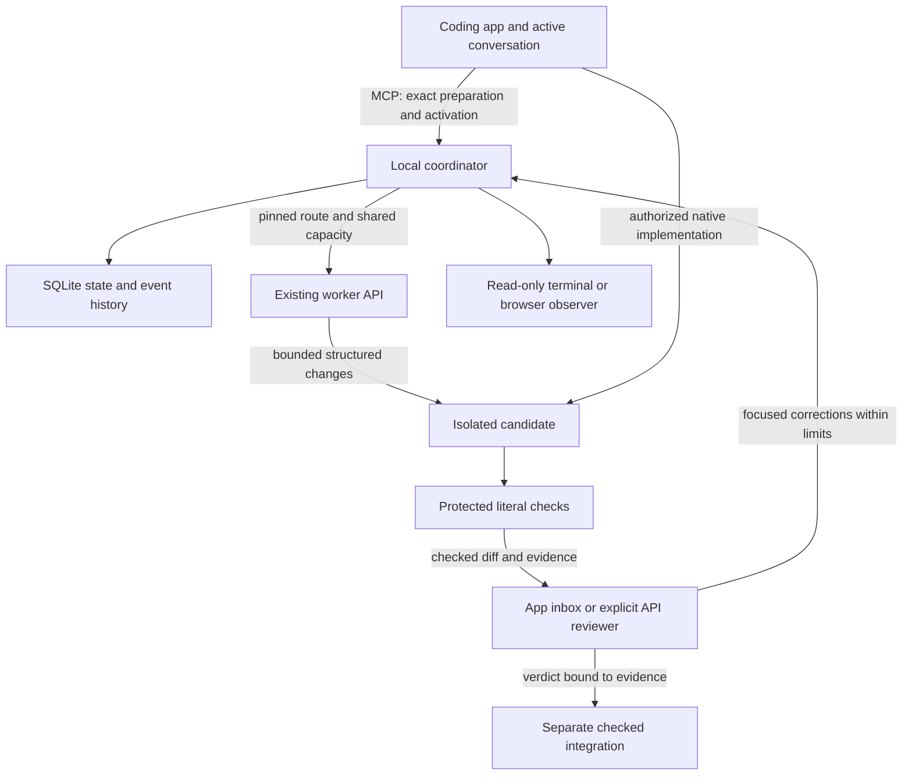

# Architecture and code map

Current orientation: November 16, 2026, source checkpoint `a23bae40d733fd711075ca798f83fbe9cc5ac633`. This describes implemented contracts and their evidence boundaries, not a universal live-qualified deployment. See the [checkpoint summary](../CHANGELOG.md).

## Current coding loop

The coding app is a control and review surface. A local coordinator owns durable state and dispatches approved work to an existing API worker or a native candidate, according to the selected mode. Protected checks and review produce evidence; they do not substitute for exact integration approval.

The arrows are governed by mode and approval contracts. They are not permission for every actor to perform every action. An API-worker response is validated before edits are applied; native implementation uses its separately owned candidate and host permissions. Scope, base, policy, runtime identity and literal check commands remain pinned through the task lifecycle.

## Modules and responsibilities

| Source | Responsibility |
| --- | --- |
| [`src/harness/coordinator.mjs`](../src/harness/coordinator.mjs), [`contracts.mjs`](../src/harness/contracts.mjs), [`store.mjs`](../src/harness/store.mjs) | Versioned goals, tasks, exact approval bindings, durable SQLite records and events. |
| [`src/harness/tools.mjs`](../src/harness/tools.mjs), [`api.mjs`](../src/harness/api.mjs), [`mcp.mjs`](../src/harness/mcp.mjs), [`cli.mjs`](../src/harness/cli.mjs) | Tool dispatch, authenticated loopback API, stdio MCP transport and service/inspection entry points. |
| [`src/harness/worker.mjs`](../src/harness/worker.mjs), [`coding.mjs`](../src/harness/coding.mjs), [`context.mjs`](../src/harness/context.mjs) | Bounded worker operations, approved task context, structured changes and check-driven progress. |
| [`src/harness/providers/`](../src/harness/providers), [`routing/`](../src/harness/routing), [`scheduling/`](../src/harness/scheduling), [`worker-profile.mjs`](../src/harness/worker-profile.mjs) | Provider roles/capabilities, explicit routes, endpoint aliases and shared capacity. |
| [`src/harness/native-candidates.mjs`](../src/harness/native-candidates.mjs), [`integration.mjs`](../src/harness/integration.mjs), [`integration-repair.mjs`](../src/harness/integration-repair.mjs) | Native candidate ownership, checked integration and focused repair with retained bindings. |
| [`src/harness/review/`](../src/harness/review), [`recovery-diagnostics.mjs`](../src/harness/recovery-diagnostics.mjs), [`artifacts.mjs`](../src/harness/artifacts.mjs) | Review evidence/reservations, recovery diagnosis and bounded artifact access. |
| [`src/harness/execution.mjs`](../src/harness/execution.mjs), [`execution-ownership.mjs`](../src/harness/execution-ownership.mjs), [`src/project/check-backends/`](../src/project/check-backends) | Execution policy, durable process ownership and protected check backends. |
| [`src/beta/cli.mjs`](../src/beta/cli.mjs), [`setup.mjs`](../src/beta/setup.mjs), [`portable-setup.mjs`](../src/beta/portable-setup.mjs), [`multi-worker-setup.mjs`](../src/beta/multi-worker-setup.mjs) | Portable CLI, migration/setup, consent, credential validation and guided worker configuration. |
| [`src/beta/hosts/`](../src/beta/hosts), [`provider-diagnostics.mjs`](../src/beta/provider-diagnostics.mjs), [`settings.mjs`](../src/beta/settings.mjs) | Manual host previews, distinct connectivity evidence, private settings and separate credentials. |
| [`src/beta/service.mjs`](../src/beta/service.mjs), [`install.mjs`](../src/beta/install.mjs), [`sources.mjs`](../src/beta/sources.mjs) | Beta service, guarded install/update/recovery and observation of separate core/beta sources. |
| [`scripts/package-beta.mjs`](../scripts/package-beta.mjs), [`scripts/lib/`](../scripts/lib) | Pinned runtime/dependency packaging, source closure, byte/mode inventory, candidate manifests and archives. |

Stable names such as `frontier-harness`, `frontier-orchestrator`, protocol actor `codex` and API-worker actor `deepseek` are compatibility identifiers. An actor alias is not proof of the actual provider or model identity. Unknown host model identity or usage must remain unknown.

## One worker first; routing when needed

A single configured worker is sufficient for the common API-worker path. Guided setup can add two or three profiles, specialties, a default and a planner. The advanced settings path supports larger pools. Selection uses explicit preferences/rules/defaults and eligibility; a busy or unavailable selected worker waits or blocks rather than silently changing provider.

The service, goal, profile and shared physical-capacity ceilings all constrain admission. Canonical endpoint aliases share capacity. Distinct URLs reaching one physical server need an explicit common group. Extra profiles and extra hardware behind one distributed API do not create independent endpoints. Concurrent source/fixture routing proof does not certify three real workers; M063 remains unproven.

## Review, recovery and permissions

App review uses a durable pull inbox, bounded evidence retrieval, a reservation and a structured submission bound to the exact task/evidence. A closed app leaves the review waiting. The coordinator does not wake an inactive chat or choose a paid fallback. An API reviewer must be explicitly selected and separately authenticated. Historical detached overnight review and current host-pull overnight configurations therefore have different availability requirements.

Each mode preserves its own actor restrictions. Collaborative and Codex-only goals explicitly allow native implementation. DeepSeek-only has no Codex implementation/review fallback. Legacy overnight uses DeepSeek planning and implementation, five attempts and at most two automatic reviews per stage by default, plus an optional explicitly requested pre-stage guidance call; it has no Codex repair path. A mode change requires supported authorization and preserves spending, deadlines and ownership.

Recovery distinguishes a stopped request from verified process quiescence. Saved responses, review reservations, check receipts and uncertain owners survive restart. Missing evidence does not become a passing check. Uncertain ownership retains capacity/scope and maintenance holds; elapsed time, a version switch or deleting state is not recovery.

## Local and cloud boundaries

The coordinator and its private state run locally. Workers receive the approved task context at the supplied endpoint; remote and hosted workers receive it off the Mac. App review may send context, diffs and evidence to the app's cloud provider even with a local worker. API review is a separate configured data and billing path. Provider credentials are resolved from private storage, not embedded in public worker identities or source files.

Portable setup separates discovery from inference consent. A model-list GET proves only what that endpoint advertised. Its optional bounded fixed-message inference probe does not prove coding quality, usable context capacity or an actual host connection. Plain schema-2 doctor does not contact workers; `doctor --providers` adds GET-only discovery. The legacy schema-1 diagnostic retains its existing discovery behavior. None of these doctor paths sends inference.

Current real-host portable registration is manual/unprobed. The generic host adapter supports conditional owned registration only with an explicitly supplied atomic comparison adapter; the disposable managed fixture is not an implementation for noncooperating real apps. See [host compatibility](HOST_COMPATIBILITY.md).

## Separate generations and installations

The original [`src/coordinator.mjs`](../src/coordinator.mjs), [`src/store.mjs`](../src/store.mjs) and [`src/demo.mjs`](../src/demo.mjs) use a JSONL text-handoff contract. [`src/live.mjs`](../src/live.mjs) adds the original live terminal adapters. The demo uses fake responses and applies no task edits or coding checks.

The preserved [`src/project/`](../src/project) runner and [`src/project-cli.mjs`](../src/project-cli.mjs) provide the legacy staged overnight workflow, with its own journal, worktree and protected checks. [`src/task-queue-cli.mjs`](../src/task-queue-cli.mjs) sequences approved legacy coding jobs. These remain available source paths; they are not the current SQLite coordinator's universal interface.

The opt-in four-mode core uses `frontier-harness`. Portable beta uses a separate `mosaic-beta` bridge, configuration and state. Its observer can read either service, but observing both does not merge goals, approvals or budgets. Research modules and historical packets remain in source; research is parked in this coding-core scope and reading them grants no dispatch authority.

## Package and qualification boundary

Current Darwin arm64 packages bundle ordinary Node 24.22.3 for the coordinator and a separate, fingerprinted Node 24.22.3 and supervisor artifact for protected checks. The check executable includes the reviewed libuv fork-path patch. Existing approvals can keep a retained Node 24.22.0 check artifact at its original path. The package inventory and checksum bind archive bytes and modes. Publisher authentication, signing and independent build reproducibility require separate evidence.

The November 16 M027 acceptance reports source, owned fixture and disposable installed-package checks at the named checkpoint. It does not establish actual app accounts, useful real-model owner projects, clean-Mac use or a public download. M001 remains blocked by the protected TCP/Unix boundary and absent Postgres proof. Broader network access needs its own capability design and approval; this documentation grants none. Dated [portable release evidence](PORTABLE_BETA_RELEASE.md) retains earlier observations and open qualification gates.
